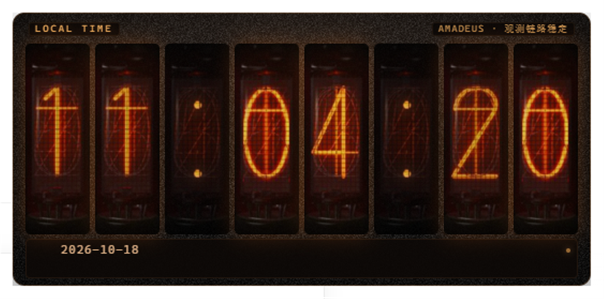
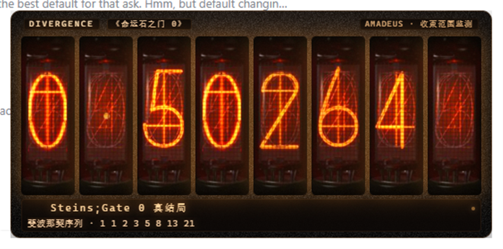
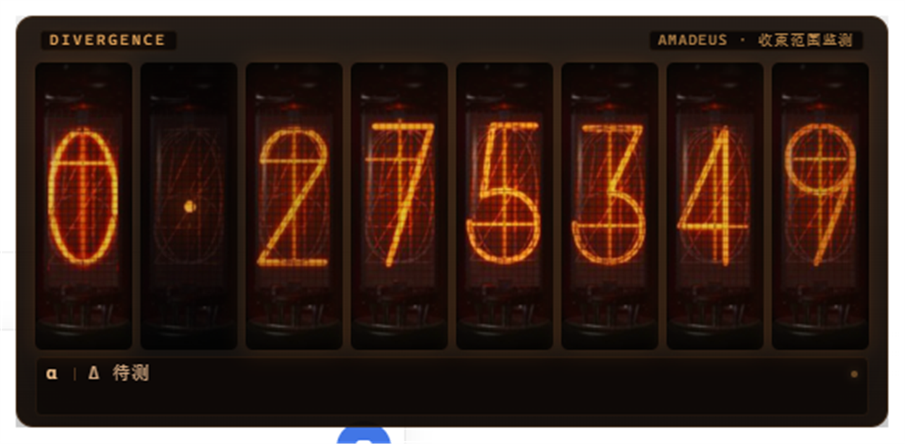
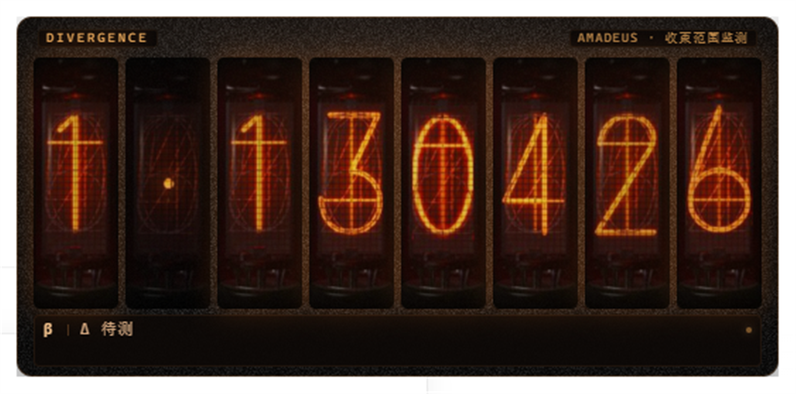
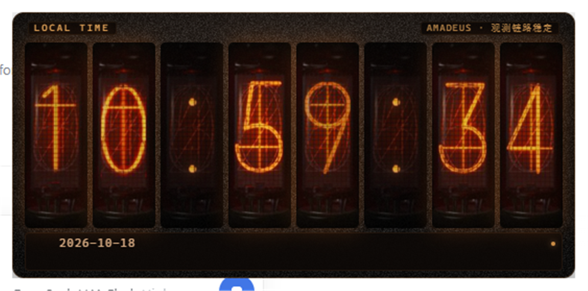
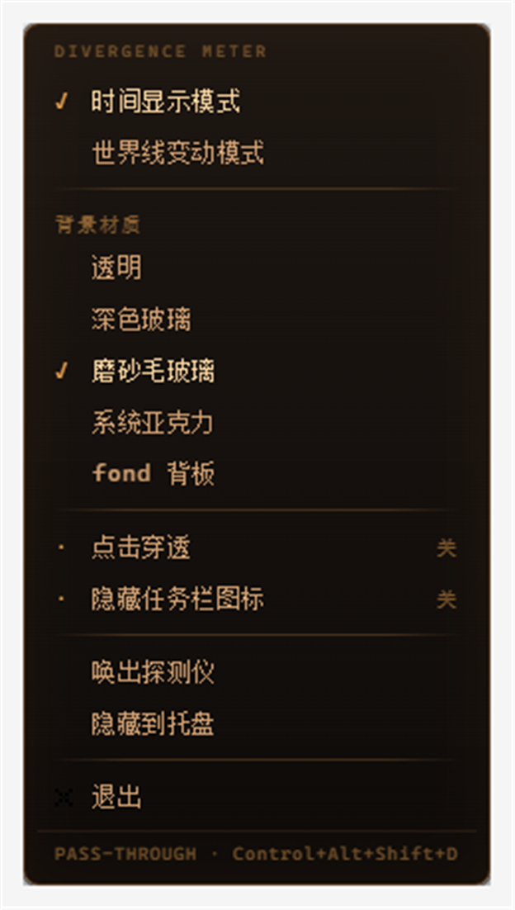
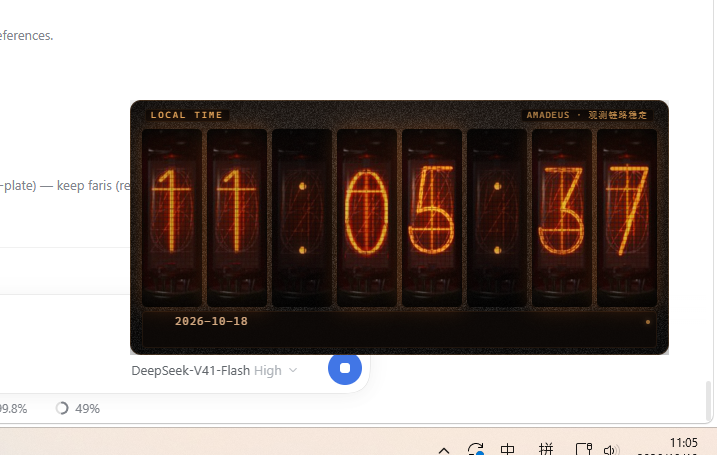

# 世界线变动率探测仪 · Worldline Divergence Meter

《命运石之门》主题的桌面宠物：8 位辉光管、Amadeus 仪表气质、时间与世界线双模式。
El Psy Kongroo.



---

## 1. 怎么运行

**方式 A（推荐，双击即用）**

```
双击 start.bat
```

**方式 B（命令行）**

```powershell
npm start            # 等价于 node launch.js
```

**方式 C（跳过启动器，直接跑）**

```powershell
npm run start:direct # 等价于 electron .
```

Electron 运行时（44.9.0）已经随 `node_modules/` 一起放在工作区里，**不需要你安装任何运行时、配置环境变量或手动编译**。
只有在 `node_modules` 丢失时，`start.bat` 才会自动执行 `npm install` 并下载运行时。

**想改参数**：编辑 `config.json`，重启程序生效。所有可调项都在这一个文件里。

**想恢复出厂状态**：删掉 `state/` 目录即可（下次启动回到「时间模式 + 1.048596」）。

### 1.1 故障排查（先看这里）

**「双击 start.bat，命令行一闪就没了，桌宠没出现」**

这个问题的真实原因已经定位并修复：

1. **`start.bat` 曾经是 UTF-8 编码，而 `cmd.exe` 用系统 ANSI 代码页（中文系统是 GBK）解析批处理文件。**
   中文 `echo` 行被按 GBK 重新切分，多字节字符会「吃掉」后面的字节，导致命令错乱
   （实测报错里能看到被截断的 `'vel'`、`'RON_MIRROR'`），**连 `if errorlevel 1 pause` 都被一起破坏**——
   于是无论成功还是失败，窗口都直接关掉，什么也来不及看。
   → 现在 `start.bat` 已改为**纯 ASCII**，不再受代码页影响。
2. **第二次双击时的行为被误报为失败。**
   程序是单实例的：已经开着一个时，再双击不会开第二个，而是把已有窗口提到前台。
   旧版启动器把这个「正常退出（exit code 0）」当成了启动失败并报错。
   → 现在会明确输出 `[ok] Already running - the existing meter was brought to the front.`

**如果还是没出现桌宠，按顺序排查：**

| 现象 | 处理 |
|---|---|
| 窗口一闪而过 | 打开 `cmd`，`cd` 到本目录后运行 `npm start`，此时错误会留在屏幕上 |
| 提示 Node.js not found | 安装 Node.js；已装则确认它进了 PATH |
| 完全没有窗口，但进程还在 | 看托盘图标（左键唤出）；或删 `state/` 重置窗口坐标 |
| 想确认它到底有没有跑起来 | 看 `logs/app.log`，正常会有一行 `pet: did-finish-load` |
| 想看点击/拖拽细节 | `npm run start:debug`（等价 `node launch.js --sgs-debug`） |

> 本机实测：默认启动方式会失败（`code=2147483651`，即 `STATUS_BREAKPOINT`——Chromium 沙箱在当前进程环境里无法初始化），
> 启动器会自动改用 `--no-sandbox` 重试并成功。**这段 `[warn]` 是预期行为，不是错误。**


---

## 2. 关于「复用 DSH 桌宠插件」——必须先说清楚的事

你的需求里提到 *「如果 DSH 环境提供了 dsh-desktop-pet、dsh-pet 或类似插件，请基于该插件进行配置和扩展」*。

我实际核查了当前 DSH 安装目录（`...\_npx\1e7f6d9597241db0\node_modules\@deepseek-ai\`）下的全部包清单，结论是：

- **不存在** `dsh-desktop-pet`、`dsh-pet` 或任何桌面窗口 / 托盘 / 桌宠相关的插件包。
  该目录里 200+ 个 `dsh-*` 包全部是 **Web GUI 与 agent 运行时**相关（`dsh-client-ui-*`、`dsh-tool-*`、`dsh-session-*` 等）。
- DSH 的插件机制面向 **浏览器 GUI（127.0.0.1:3080）与服务端 agent 能力**，没有「创建操作系统级窗口 / 系统托盘」这一层能力。

所以「基于 DSH 桌宠插件扩展」这条路在当前环境里**客观不存在**。我没有虚构它，而是选择了独立实现，并把这个判断写在这里供你复核。
（如果 DSH 后续补上了这类插件，本项目的 `config.json` 与 `src/worldline.js` 可以直接复用。）

---

## 3. 技术选型与理由

| 选项 | 结论 | 理由 |
|---|---|---|
| **Electron 44.9.0** | ✅ 采用 | 唯一能同时稳定满足「逐像素透明窗口 + 置顶 + 无边框 + 系统托盘 + 点击穿透 + 自绘菜单」的方案，且只需 `npm install`，无需 Rust/编译器 |
| Tauri | ❌ | 需要 Rust 工具链，违反「不得要求手动安装运行时」 |
| WPF / C# | ❌ | 需要 .NET SDK 与首次 restore，交付链路更脆 |
| Python + tkinter | ❌ | `-transparentcolor` 只支持单一色键透明，做不出「辉光管玻璃 + 外围完全透明」的层次，托盘还要额外装 pystray |

代价（如实说明）：常驻约 **4 个进程 / 325 MB 工作集**。这是 Chromium 架构的固有成本，换来的是渲染质感与窗口能力。

---

## 3.1 美术素材与资源管线

`image/` 里的素材被完整用了起来（原件**只读**，一个字节都没有改）：

| 素材 | 用途 |
|---|---|
| `0.png` … `9.png`（104×307） | 8 个管位的数字管体 |
| `empty.png` | ① 分隔符管位的"未点亮"管体 ② 特殊值闪烁时偶尔整管熄灭 |
| `dot.png` | 剥出小数点光点；世界线模式 1 个点、时间模式 2 个点组成冒号 |
| `croix.png`（5×5 `×`） | 右键菜单「退出」项的图标（按像素放大保持锐利） |
| `fond.png`（3840×2160） | 缩成 1280×720 的 `fond-panel.png`，仅 `background: "fond"` 时作背板 |
| 生成的 `noise.png`（96×96） | 磨砂材质的细噪点贴图（程序生成，不是你的素材） |

**为什么需要中间处理**：这些管体图是**不透明黑底**的照片裁切（角点 `A=253, RGB=0`），
直接放进透明窗口会得到 8 个黑方块；而黑底带 JPEG 噪点，按"纯黑"抠图会留下毛边。

所以 `tools/prepare-assets.ps1` 做两件事（幂等，可随时重跑）：

1. **管体 → 圆角矩形遮罩**（半径 8px、1px 抗锯齿），再按亮度调制 alpha：
   数字与灯丝 `alpha=1`，暗玻璃管体 `alpha≈0.85`。
   这样既保住"暗色玻璃管轮廓"，又不会在浅色桌面上糊成一块死黑。
2. **小数点 → 按亮度抠成裸光点**（阈值 72）。它在管体内部，方形裁切会带上暗管壁；
   低 alpha 的暗管壁在浅色桌面上会显成一个灰方块，所以必须按亮度扣掉。

产物在 `src/assets/`（约 1 MB），原始素材仍在 `image/`，方便你替换或重新生成：

```powershell
powershell -NoProfile -ExecutionPolicy Bypass -File tools\prepare-assets.ps1
```

> 想换一套素材：把新的 `0-9/empty/dot` 放进 `image/`（保持同名同尺寸）再跑一次脚本即可。

---

## 4. 完成情况

### 4.1 已实现并通过验证

| # | 需求 | 状态 | 验证方式 |
|---|---|---|---|
| 1 | 默认时间模式，`HH:MM:SS`，每秒刷新不跳秒 | ✅ | 集成测试实测系统时间比对；连续 3 秒逐秒 +1 |
| 2 | 右键菜单，双模式切换（当前项打勾） | ✅ | 真实 DOM 事件 + 菜单窗口页面内断言 |
| 3 | 世界线模式 8 位显示 `1.048596` 格式 | ✅ | 集成测试正则 + 逻辑测试 |
| 4 | 点击必变化，幅度总体轻微 | ✅ | 20 次真实点击每次都变、且点击计数严格 +1；3000 次抽样末两位内占比 ≥80% |
| 5 | 特殊值概率 3%–8%，附带提示文本 | ✅ | 配置 5%；20000 次采样校验；另加 pity=60 保底 |
| 6 | 特殊值命中时「急速闪烁跳动」再落定 | ✅ | 集成测试捕获到动画中间帧（如 `1.192287`）与落定值不同 |
| 7 | 17 个特殊值全部接入（含 1 条负值） | ✅ | 逐个断言数值、标签、台词、章节（见 §5） |
| 7.1 | 特殊值台词可自定义 + 品牌名可改 | ✅ | `texts.json`（见 §6.1） |
| 7.2 | 顶部 `DIVERGENCE` 旁显示章节 | ✅ | 有值才显示胶囊，无值不留空（见 §5 注） |
| 8 | 8 位独立辉光管 + 小数点独立管位 | ✅ | **使用 `image/` 实拍素材**逐管渲染；小数点占独立管位、常亮低亮度 |
| 9 | 暖琥珀辉光、暗色玻璃管轮廓、扫描线、极细边框 | ✅ | 见 `screens/` 截图；扫描线可用 `appearance.scanlines` 开关 |
| 9.1 | 背景材质可切换（含磨砂/亚克力） | ✅ | 右键菜单 + 托盘；5 种材质，选择持久化（见 §6 注） |
| 10 | 背景透明、置顶、可拖拽 | ✅ | 透明窗口 + `alwaysOnTop('screen-saver')` |
| 11 | 拖拽不触发变动率 | ✅ | 真实移动光标拖拽，断言 `dragged=true` 且数值不变 |
| 12 | 点击穿透可切换 | ✅ | Win32 层面断言窗口带 `WS_EX_TRANSPARENT (0x20)`，关闭后消失 |
| 12.1 | **穿透后能恢复互动**（不许变成陷阱） | ✅ | 状态条常驻提示 + 全局快捷键（自动化测试真的发了一遍 `Ctrl+Alt+Shift+D` 并断言 exStyle 的 `0x20` 位消失） |
| 13 | 隐藏任务栏图标 + 托盘入口 | ✅ | `setSkipTaskbar` + 断言托盘存在（穿透/隐藏时**强制**保底托盘） |
| 14 | 配置集中、修改后重启生效 | ✅ | `config.json` 单文件；测试校验键集合与内置默认值一致 |
| 15 | 状态持久化 | ✅ | 模式/数值/穿透/任务栏/位置/特殊值历史；实测重启后 `mode=worldline` 正确恢复 |
| 16 | 自动化启动，无需手动装运行时 | ✅ | `start.bat` / `launch.js` 自检 + 自动回退 |

**测试总计：45 项自动断言全部通过（21 项逻辑 + 24 项集成）。**

### 4.2 降级、限制与如实说明

1. **美术素材经过了派生处理（原件未改动）**：`image/` 里的管体图是不透明黑底照片，直接铺进透明窗口会变成 8 个黑方块。因此由 `tools/prepare-assets.ps1` 生成 `src/assets/`：
   - 管体按**圆角矩形遮罩**裁切（半径 8px，1px 抗锯齿），再用亮度调制 alpha——数字与灯丝完全不通明，暗玻璃管体保留约 0.85 的透明度，于是既保住"暗玻璃管"轮廓，又不会在浅色桌面上糊成一块死黑。
   - 小数点是从 `dot.png` 里按亮度抽取的**裸光点**（阈值 72），因为暗管壁在低 alpha 下会在浅色背景上显出灰方块。
   - 处理是**幂等**的，随时可重跑；`image/` 只读。
2. **管体不是矢量/不是原作字体渲染**：用的是实拍照片本身，所以数字粗细、网格纹理都来自素材，无法像字体那样任意换字号。这是使用素材的必然结果，也是"更像真的辉光管"的原因。
3. **「8 位 vs 10 字符」的需求内部不一致**：`1.048596` 实际是 **8 个字符**（1 位整数 + 小数点 + 6 位小数）；需求里「长度为 10 个字符」与同段的「8 个辉光管位」互相矛盾。我以**表格给出的 `1.048596` 格式和「8 位」**为准，小数点单独占第 2 个管位。
   顺带的好处是：`HH:MM:SS` 也正好是 8 个字符，两个模式共用同一排 8 支管，切换时管位不会跳变。
4. **负值处理**：按需求「落在负值区间时不显示负号」，实现上把结果**夹到 `0.000000`**（而不是显示绝对值，那会让读数与真实状态不符）。
5. **Chromium 沙箱**：在受限进程环境（例如本会话的沙箱）里 Chromium 无法初始化自身沙箱，Electron 会在执行任何 JS 前直接退出（`STATUS_BREAKPOINT`，双击表现为「没反应」）。`launch.js` 因此先按默认方式启动并观察 2.5 秒，失败才自动改用 `--no-sandbox` 重试。**注意**：`--no-sandbox` 会削弱渲染进程隔离；本程序只加载本地文件、不访问远程内容，风险可控，但这是一项真实的安全取舍。
6. **托盘图标仍为程序化绘制**（暗色圆盘 + 琥珀光环 + 中央灯丝），`image/` 里没有托盘尺寸的图标。
7. **`fond.png`（3840×2160）默认不铺开**：它整张铺上去会变成一大块深色背景，与"不遮挡桌面"冲突。它被缩成 `src/assets/fond-panel.png`，只在 `appearance.background: "fond"` 时才作为背板使用。
8. **「任务栏图标消失」的视觉结果未做像素级自动验证**：我验证的是 `setSkipTaskbar` 调用生效、状态落盘、且托盘入口存在。按钮消失本身是 Electron 官方 API 的确定行为。
9. **托盘/菜单均为自绘**：右键菜单是独立的小窗口（`menu.html`），不是 Windows 原生菜单——这样能保证与仪器一致的视觉。托盘菜单则是原生 `Menu`（作为穿透状态下的救命入口）。菜单「退出」项的小 `×` 用的就是素材里的 `croix.png`（5×5，按像素放大）。
10. **无语音**：需求只要求文本，未接入语音。
11. **未在「你的真实用户令牌」下验证启动**：本会话始终在受限令牌里，因此走的是 `--no-sandbox` 回退路径。普通双击（Explorer 启动）应当走默认路径，启动器对两种都覆盖。
12. **`uiScale` 缩放**通过 `webContents.setZoomFactor` 实现，未做多显示器 DPI 的逐屏适配；窗口位置在多屏间移动会被夹回可见工作区。
13. **深色材质现在是默认**（`appearance.background: "frosted"`）：纯透明在浅色桌面上确实突兀。默认用**自绘磨砂**（深色渐变 + 噪点），管子方框边缘能融进背景；`dark` 是干净深色板，`none` 回到全透明。
14. **原生亚克力没能验证出真模糊**：理由与处理见 §6 的 ⚠️ 说明。我把它保留为可选项，但页面层压了深色，避免它退化成白板。
15. **文案与参数分家**：`config.json` = 行为参数，`texts.json` = 文案。这是应你的要求新加的，代价是"所有可调项集中在一个文件"不再字面成立——但改台词/品牌名不必再翻数值配置，我认为更实用。
16. **章节栏大量留空是我故意的**：具体哪条世界线属于游戏第几章，我没有可靠依据，不想写错让你当真。填进 `texts.json` 就会显示。
17. **台词行的空间是常驻预留的**：特殊值那一行在平时是空着的（约 13px），这样命中时窗口不会突然长高、把管子挤动。
18. **顺手修掉一个会坑到用户的 bug**：以前 `readJson` 直接 `JSON.parse` 文件内容，而记事本 / Windows PowerShell 的「UTF8」会写入 **BOM**，`JSON.parse` 拒绝解析——结果就是你手改过的 `config.json` / `texts.json` 会被判成"损坏"、备份后重建默认值，改动白做。现在读取时会先剥掉 BOM。

---

## 5. 特殊世界线一览（17/17 已接入）

| 数值 | 标签 | 第二行（台词 / 语境） | 章节 / 出处 | 权重 |
|---|---|---|---|---|
| `1.048596` | Steins;Gate 世界线 | 「一切都是 Steins;Gate 的选择」 | 第十章 | 0.9 |
| `1.123581` | Steins;Gate 0 真结局 | 斐波那契序列 · 1 1 2 3 5 8 13 21 | 《命运石之门 0》 | 0.9 |
| `1.130426` | β 世界线 | 一切开始之前的那条线 | — | 1.0 |
| `1.130205` | β 世界线 | 2010-08-17 · 删除第一封 D-mail | 红莉栖 END | 1.0 |
| `1.130238` | β 世界线 | 2010-08-17 · 删除第一封 D-mail | 真由理 END | 1.0 |
| `1.129848` | β 分歧点 | 重要分歧点附近 | — | 1.0 |
| `1.382733` | β 变动 | 俄罗斯时间机器实验之后 | — | 1.0 |
| `0.571024` | α 世界线 | 2010-07-28 · 第一封 D-mail 之后 | — | 1.0 |
| `0.571015` | α 六合彩 | 2010-07-28 · 六合彩 D-mail | — | 1.0 |
| `0.523307` | α 世界线 | 2010-08-15 · 四千次时间跳跃之后 | — | 0.8 |
| `0.523299` | α 世界线 | 2010-07-31 · IBN5100 被夺走 | — | 0.8 |
| `0.456903` | α 世界线 | 2010-08-06 · 琉华子的 D-mail | — | 1.0 |
| `0.409420` | α 世界线 | 2010-08-07 · 菲利斯寄往 2000 年的 D-mail | — | 1.0 |
| `0.337187` | α 世界线 | 2010-08-10 · 尾行铃羽的 D-mail | — | 1.0 |
| `-0.275349` | 菲利斯线 | 负向变动率 · 探测仪不显示负号 | — | 0.7 |
| `2.615074` | γ 收束范围 | 广播剧《暗黑次元的海德》 | 广播剧 | 1.0 |
| `2.999999` | γ 边界 | γ 收束范围的边缘 | — | 0.7 |

- 触发概率：`worldline.specialChance = 0.05`（5%，落在建议的 3%–8% 内）
- 保底：`worldline.pityAfterMisses = 60`，即最坏情况 60 次点击内必出一次特殊值
- 标签 / 第二行 / 章节**全部在 `texts.json` 里**，改完重启即可，不用碰 `config.json`
- 收束范围按 α(<1%) / β(1%–2%) / γ(2%–3%) 在状态条左侧实时显示
- **章节一栏我故意留空了大半**：具体每条世界线对应游戏第几章，我没有可靠依据，不想编。`texts.json` 里填上就会显示在 `DIVERGENCE` 右边；空着就不显示（不会留空胶囊）。已填的几条中，`第十章` 是主线终章，两条 `END` 与 `广播剧` 来自你给的资料。

### 关于那条负值 `-0.275349`

菲利斯线是一条**负向**世界线。原作探测仪不能显示负号，需求里也写明「落在负值区间时不显示负号」，所以：

- `config.json` 里如实存成 `-0.275349`（忠于设定）
- 管面按**幅值**显示 `0.275349`（8 位，不带负号），状态条仍标 `α`
- 命中后继续点击，数值会在负值区**小步漂移**，不会"啪"地跳回 0——否则那一刻的位移会远大于「轻微变化」的定义

如果你更希望它命中后立刻回到正区间，把 `worldline.min` 之外再加个开关也行，告诉我即可。



负向世界线的实机样子（显示 `0.275349`，无负号）：



### 界面一览

世界线变动模式（`Δ 待测` 为静息态，点一下就会变成 `Δ ±0.0000xx`）：



默认材质「磨砂毛玻璃」——深色渐变 + 细噪点，管子方框边缘融进背景：



自绘右键菜单（当前模式打勾，开关项显示 开/关）：



在最大化窗口之上置顶运行（注意它盖在 QQ 窗口上方，且不遮挡周围内容）：



---

## 6. 配置项（`config.json`）

| 键 | 默认 | 说明 |
|---|---|---|
| `window.alwaysOnTop` | `true` | 置顶级别 `screen-saver` |
| `window.startMode` | `"time"` | 首次启动的模式 |
| `window.restoreLastMode` | `true` | `true` 恢复上次模式；`false` 则每次都用 `startMode` |
| `window.clickThrough` | `false` | 穿透**默认值**（仅影响首次启动） |
| `window.showTrayIcon` | `true` | 是否创建托盘 |
| `window.hideTaskbarIcon` | `false` | 是否隐藏任务栏按钮（首次启动） |
| `window.hideOnStart` | `false` | 启动即隐藏到托盘 |
| `window.rememberPosition` | `true` | 记住窗口位置 |
| `window.toggleClickThroughHotkey` | `"Control+Alt+Shift+D"` | 全局快捷键：切换穿透 |
| `time.twentyFourHour` | `true` | 12/24 小时制 |
| `worldline.min` / `max` | `0` / `2.999999` | 数值范围 |
| `worldline.initialValue` | `1.048596` | 首次启动的变动率 |
| `worldline.specialChance` | `0.05` | 特殊值概率 |
| `worldline.pityAfterMisses` | `60` | 保底次数，`0` 关闭 |
| `worldline.deltaTiers` | 见文件 | 变化幅度分层：权重 / 最小 / 最大（单位 1e-6） |
| `worldline.specialValues` | 7 项 | 特殊值表（数值 + 文本 + 权重） |
| `interaction.dragThresholdPx` | `5` | 超过该位移判定为拖拽（不触发点击） |
| `interaction.specialAnimationMs` | `820` | 世界重构闪烁时长 |
| `interaction.specialLabelHoldMs` | `6000` | 特殊值提示文本停留时长 |
| `appearance.uiScale` | `1.0` | 整体缩放 |
| `appearance.showHeader` | `true` | 顶部标签 |
| `appearance.scanlines` | `false` | 扫描线纹理（素材本身已有玻璃纹理，默认关） |
| `appearance.background` | `"frosted"` | 默认材质，5 选 1，也可在右键菜单/托盘里切换（见下） |

> **`appearance.background` 的 5 个选项**（右键菜单「背景材质」分组可实时切换，选择会记住）：
>
> | 值 | 菜单里叫 | 说明 |
> |---|---|---|
> | `none` | 透明 | 完全透明，只剩管体和小字底衬 |
> | `dark` | 深色玻璃 | 干净的深色板 |
> | `frosted` | 磨砂毛玻璃 | **默认**。深色渐变 + 96×96 细噪点 + 内阴影，管子边缘融进背景，方形轮廓最不明显 |
> | `acrylic` | 系统亚克力 | 走 Windows 原生 `backgroundMaterial`，需要非透明窗口（会重建窗口） |
> | `fond` | fond 背板 | 用 `image/fond.png` 作背板 |
>
> ⚠️ **关于 `acrylic` 的诚实说明**：我实现了原生材质路径（`BrowserWindow({ backgroundMaterial: 'acrylic' })`，非透明窗口），
> 但**在这个环境里没能验证出真实模糊**——无论加不加 `backgroundColor`，窗口都渲染成一块实色，透不出背后内容
> （我用"窗口压在文字密集处 + 清空页面底色"的方式截图比对过）。
> 因此页面层又压了一层深色，保证它最差也只是"另一种深色板"，不会变成刺眼的白板。
> 如果你在别的机器/主题下看到它真在模糊，那更好；但我不敢把它当"已验证功能"写给你。真正可靠的是 `frosted`。


> 顶部/底部的小字另有一层**几乎不透明**的暗色底衬（只覆盖文字本身），保证任何壁纸下都读得清。
> `worldline.specialValues` 现在只保留 `value` 和 `weight`（**数值与概率**）；
> 标签、第二行台词、章节这些"给人看的字"全部搬到了 `texts.json`。

### 6.1 文案文件 `texts.json`

除了 `config.json`（行为参数），新增了一个专门放文案的文件，改台词不用再翻大配置：

```json
{
  "brand": "AMADEUS",
  "status": {
    "time": "观测链路稳定",
    "worldline": "收束范围监测"
  },
  "worldlines": {
    "1.048596": {
      "label": "Steins;Gate 世界线",
      "quote": "「一切都是 Steins;Gate 的选择」",
      "chapter": "第十章"
    }
  }
}
```

- `brand`：牌子名（原来写死的 `AMADEUS`）；`status.time` / `status.worldline` 就是 **AMADEUS 后面那句**
- `worldlines` 的**键 = 管面上显示的数字**（负值按幅值，菲利斯线用 `0.275349`）
- `label` → 状态条第一行；`quote` → 第二行台词；`chapter` → 顶部 `DIVERGENCE` 右边的胶囊
- 只写你想改的条目即可，其余自动用内置默认；解析失败会备份成 `texts.json.broken-*` 并重建
- 记事本存出来的 BOM 也能正确读取

---

## 7. 穿透 / 隐藏之后怎么回来（重要）

### 先纠正我上一版说错的地方

上一版我写"托盘图标只是被收进了溢出区"。**这个结论是错的**——你截图里的 `^` 溢出面板只有 4 个图标，没有我们的。
所以真相是：**图标在这台机器上根本没有被系统显示出来**，不是"藏起来了但还在"。

证据链：

- 图标对象本身没问题：`nativeImage` 读出 `{width:16,height:16}, empty=false`（日志里有）；
- 但也换成了真实 PNG 文件（不再手拼 bitmap），结果一样；
- `tray.getBounds()` 恒为 `{x:0,y:0,width:0,height:0}`；
- 你的溢出面板里没有它。

我没有权限去改 Windows 的托盘行为，所以**不再把"找回来"这件事押在托盘上**。

### 现在实际可用的四条路

| 层 | 手段 | 验证状态 |
|---|---|---|
| **1** | **穿透时桌宠右上角浮出一个 26×26 的小把手**（琥珀色三横线），它**永不穿透**，点一下就恢复互动 | ✅ 截图确认显示；并把窗口 `moveTop()` 抬到桌宠之上 |
| **2** | 状态条第二行**常驻**显示 `点击穿透中 · … 可恢复` | ✅ 截图确认 |
| 3 | 全局快捷键 `Ctrl+Alt+Shift+D` / `Ctrl+Alt+Shift+S` | ⚠️ 注册成功，但**在这个环境里时灵时不灵**（实测成功过一次，之后就不触发）；怀疑被中文输入法的 `Alt+Shift` 组合吃掉。所以我没把它当唯一出路 |
| 4 | 从菜单开关穿透时**菜单不关闭**，可立刻再点一次撤销 | ✅ 菜单窗口本身不受穿透影响 |

### 「隐藏窗口」不会再把你困住

隐藏之后如果托盘图标不可见，**15 秒后自动把窗口放回来**，并在状态条说明原因。
配置项 `window.autoShowIfTrayHiddenMs`（默认 `15000`，设 `0` 关闭）。

这条已经实测：隐藏后日志出现 `tray icon not visible -> auto show in 15000 ms`，
15 秒后出现 `auto show: restored window because tray icon is invisible`，截图确认窗口回来了。

> `Notification`（Windows 通知气泡）会在开启穿透时提示快捷键。代码在，但**我没能确认它弹出来**——
> 未签名的 Electron 应用常被系统抑制通知。不要依赖它。

### 仍然存在的限制，说清楚

- **托盘图标在这台机器上不可见**，这是环境问题，我改不动；换一台机器/换个 Windows 主题可能会正常出现。
- **快捷键在这个环境不稳定**，我没有把它当作唯一逃生口。
- 因此"最可靠"的是第 1 条：那个小把手。它是个独立的小窗口，不参与穿透。

### 顺带修掉的坑

- `ensureTray()` 原本会**因为配置里 `showTrayIcon: false` 而直接返回**，于是"关掉托盘 + 开穿透"就会彻底没有出口。现在穿透/隐藏任务栏图标时会 `ensureTray(true)` 强制创建。
- 尝试过"鼠标悬停显示提示"（`setIgnoreMouseEvents(true,{forward:true})` 转发 mousemove），**实测转发事件数为 0**，已删除，没有留装样子的代码。

---

## 7.1 状态文件

`state/state.json`（自动生成，无需手改）：

```json
{
  "mode": "worldline",
  "clickThrough": false,
  "skipTaskbar": false,
  "window": { "x": 1310, "y": 771 },
  "worldline": {
    "micro": 1129848,
    "missesSinceSpecial": 17,
    "clicks": 42,
    "history": [{ "value": 1.382733, "label": "β 变动", "at": "..." }]
  }
}
```

变动率以**整数微单位**（`value × 1e6`）存储，避免浮点误差（`1.048596` 不会变成 `1.0485959…`）。
文件损坏时自动回退默认值并继续运行，不会崩。

---

## 8. 测试与复现

```powershell
npm test                 # 19 项逻辑验收（纯 Node，不需要启动界面）
node launch.js --remote-debugging-port=9222   # 启动并开放调试端口
npm run test:integration # 22 项集成验收（驱动真实窗口）
```

- `test/acceptance.js`：格式、边界、必变化、幅度分布、命中率、7 个特殊值、收束范围、配置键一致性、持久化与损坏容错
- `test/integration.js`：通过 DevTools 协议驱动**正在运行的窗口**，发送真实 DOM 鼠标事件，并用 Win32 读取窗口扩展样式来断言穿透状态

集成测试里的两个关键手法（也是踩坑记录）：

- **拖拽 vs 点击**：窗口会跟着光标移动，渲染层的 `mousemove` 不可靠，所以由主进程以 16ms 轮询 `screen.getCursorScreenPoint()`，位移超过阈值才搬窗口；`pointerUp` 返回 `dragged`，渲染层据此决定是否算点击。
- **点击必须"一次算一次"**：点击事件串行排队执行（`drainClicks`），避免两次点击的 IPC 返回乱序而互相覆盖；特殊值动画期间到达的点击会排队而非丢弃，因此「每点必变」在快速连点下也成立。

---

## 9. 文件结构

```
DesktopPet/
├── start.bat                 双击启动（缺运行时则自动安装）
├── launch.js                 启动器：探测启动方式，必要时回退 --no-sandbox
├── config.json               行为参数（数值、概率、窗口、材质、交互）
├── texts.json                文案（品牌名、状态行、每条世界线的标签/台词/章节）
├── package.json
├── src/
│   ├── main.js               主进程：透明窗口/托盘/穿透/拖拽/菜单/持久化
│   ├── preload.js            contextBridge 白名单 API
│   ├── worldline.js          世界线核心逻辑（纯函数，可单测）
│   ├── store.js              配置合并与状态原子读写
│   ├── icon.js               程序化生成托盘图标
│   ├── assets/               由 image/ 派生的运行资源
│   │   ├── tubes/0-9.png     抠好底的数字管体（104×307）
│   │   ├── tubes/empty.png   未点亮的管体（用于分隔符与闪烁）
│   │   ├── dot.png           小数点裸光点
│   │   ├── croix.png         菜单「退出」的 × 图标
│   │   ├── noise.png         磨砂材质的噪点贴图（生成）
│   │   └── fond-panel.png    可选背板
│   └── renderer/
│       ├── pet.html/.css/.js   8 位辉光管渲染 + 交互 + 特殊动画
│       └── menu.html/.css/.js  自绘右键菜单
├── image/                    原始美术素材（只读，程序不改动）
├── tools/prepare-assets.ps1  素材 → src/assets 的派生脚本（幂等）
├── state/state.json          运行时状态（自动生成）
├── logs/app.log              启动与错误日志（--sgs-debug 可看交互细节）
├── test/                     逻辑 + 集成验收脚本
└── screens/                  交付截图
```

---

## 11. 打包（不签名）

### 产物

```powershell
powershell -ExecutionPolicy Bypass -File tools\build-portable.ps1
```

生成 `dist\WorldlineDivergenceMeter\`（约 370 MB）绿色版：

| 文件 | 说明 |
|---|---|
| `WorldlineDivergenceMeter.exe` | 主程序（**未签名**） |
| `Start.bat` | 一键启动：先正常启动，3 秒内没起来就自动用 `--no-sandbox` 重试 |
| `resources\app\` | 程序本体 |
| `config.json` / `texts.json` | **首次运行时生成在 exe 同目录**，可直接改 |

配置、文案、状态、日志都写在 exe 旁边（绿色版逻辑），不再埋进 `resources` 里。

打包没有用 electron-builder / electron-packager——它们要额外下载；这里只是「复制 Electron 运行时 + 改名 exe + 把应用放进 `resources\app`」，手写足够且不依赖网络。

### 11.1 安装包（Setup.exe）

```powershell
powershell -ExecutionPolicy Bypass -File tools\make-installer.ps1
```

产物：`dist\WorldlineDivergenceMeter-Setup.exe`（**111 MB**，lzma 压缩率 29.4%）。

按用户安装，**不需要管理员权限**：

| 动作 | 结果 |
|---|---|
| 安装位置 | `%LOCALAPPDATA%\Programs\WorldlineDivergenceMeter` |
| 开始菜单 | `Worldline Divergence Meter\` → 程序 + **README** |
| 桌面 | 程序快捷方式 |
| 「应用和功能」 | 写入卸载项（`HKCU\...\Uninstall\WorldlineDivergenceMeter`） |
| 卸载 | 安装目录里的 `uninstall.exe`，或 设置 → 应用 → 卸载 |
| 附带 | **README.md 一起装进去**，开始菜单给了入口 |
| 升级 | 不覆盖用户改过的 `config.json` / `texts.json`（打包时已剔除，首启自动生成默认值） |
| 卸载时 | **保留**配置/台词/状态，避免误删手写内容 |

用的是 **NSIS 3.04**（从 npmmirror 的 electron-builder-binaries 取的：github.com 不可达，自带的 7-Zip SFX 又不支持自动运行脚本）。

**NSIS 不进仓库**（`tools/nsis/` 已写进 `.gitignore`，那是一份 7 MB、数百个文件的第三方发行版，还含 linux/mac 无用目录）。
缺了会自动取：`tools\make-installer.ps1` 检测不到 `makensis.exe` 时会调用 `tools\get-nsis.ps1`
下载固定版本 `nsis-3.0.4.1.zip`（28 MB）并摊平解压到 `tools\nsis\`，之后编译完全离线。

所以新克隆的仓库只要跑一次 `tools\make-installer.ps1` 就能出安装包，不需要手动准备 NSIS。

> 先试过 Windows 自带的 **IExpress**：在这台机器上连最小样例都编译失败（exit 1、无产物），已放弃。

### 11.2 安装包的验证边界（重要，别当成全绿）

实测安装包：**文件部分成功**，但三项被本机沙箱拒绝：

```
startmenu=mkdir failed      <- 开始菜单目录创建被拒
shortcut-app=failed         <- 快捷方式被拒
shortcut-readme=failed
shortcut-desktop=failed
registry=denied             <- 注册表写入被拒
done=1
```

我单独验证过这是**环境限制**而不是安装器的问题——这个会话里直接写 `HKCU` 注册表、写「开始菜单」目录、建 `%LOCALAPPDATA%\Programs`，三项全部 `Access is denied`。

| 项目 | 状态 |
|---|---|
| 编译出 Setup.exe | ✅ 已验 |
| 解包全部文件（含 README / uninstall.exe / resources） | ✅ 已验（`/D=` 装到可写目录） |
| 开始菜单 / 桌面快捷方式 | ⚠️ 本机沙箱内无法验证 |
| 「应用和功能」卸载项 | ⚠️ 同上 |
| 卸载程序 | ⚠️ 静默卸载在本机卡住，**未跑通** |

安装器会把每一步写进 `安装目录\install-log.txt`；快捷方式没建成时，非静默安装会弹提示「程序已装好，但快捷方式被系统拒绝」，**不会假装成功**。

你在正常桌面上双击 `Setup.exe` 时这些步骤应当正常完成——但我不说"已验证"，因为我这里确实被系统挡住了。
### 关于签名：已按你的要求取消

之前做过一轮自签名（`tools\sign.ps1`），现已全部撤销：

- `dist` 里的 exe 重新打包过，当前 **`NotSigned`**；
- 我为签名装进「当前用户 → 受信任的根证书颁发机构」的那张自签名证书**已删除**（`CurrentUser\Root` 与 `CurrentUser\My` 均无残留，已复查）；
- 原始 `node_modules\electron\dist\electron.exe` 本身就是 `NotSigned`，所以打包产物不带任何第三方签名。

`tools\sign.ps1` 文件还留着（不运行就不产生任何效果），将来若拿到正式 CA 证书可以直接接上：

```powershell
powershell -ExecutionPolicy Bypass -File tools\sign.ps1 -Pfx 正式证书.pfx -PfxPassword 密码
```

未签名的代价，说清楚：**首次运行大概率会遇到 SmartScreen 的「Windows 已保护你的电脑」**，需要点「更多信息 → 仍要运行」。
这是所有未签名 exe 的正常表现，不是程序有问题。

### 已知不足

- exe 的**图标与版本信息仍是 Electron 自带的**（改名不改资源）。要换成自己的图标/版本号需要 `rcedit`，当前环境没有，我没装。
- 打包产物约 370 MB（Electron 运行时占绝大部分）。想分发可以自己压 zip，能压到约 150 MB 左右。
- 没有做安装包（installer）。当前是绿色版，解压即用、删目录即卸载。
## 12. 操作速查

| 操作 | 结果 |
|---|---|
| 左键单击（世界线模式） | 变动率轻微偏移，状态条显示 `Δ` |
| 左键单击（时间模式） | 状态条回一行「时间坐标已锁定」，时间不变 |
| 按住左键拖动 | 移动窗口，**不会**改变变动率 |
| 右键单击 | 弹出菜单（模式 / 穿透 / 任务栏 / 托盘 / 退出） |
| 穿透中想恢复 | 状态条第二行的提示 / `Ctrl+Alt+Shift+D` / 托盘左键（会自动关掉穿透）/ 托盘右键第一项 |
| 托盘左键 | 唤出探测仪；若正在穿透，顺带关闭穿透 |
| 托盘右键 | 原生菜单（穿透、任务栏、退出都在）；穿透时首项是「⚠ 关闭点击穿透」 |

---

*这不是命运石之门的选择，只是一个桌面挂件。但至少它每次都会变一点点。*

---

## 13. 素材与版权（重要）

> **更新（v1.1）**：默认外观已改为**纯 CSS 数码管**（最初没有美术素材时的样子）。
> 仓库里的 `src/assets-default/` 现在只保留支撑文件（关闭图标、噪点、托盘图标），
> 不再包含管子图片。两种外观的切换规则见 **第 14 节**。

### 本仓库不含任何第三方美术素材

`image/` 目录**不在本仓库里**（已写进 `.gitignore`）。仓库里提交的只有：

| 目录 | 内容 | 归属 |
|---|---|---|
| `src\assets-default\` | 数码管、分隔点、关闭图标、底图 | **本项目所有**，由 `tools\make-art.ps1` 程序绘制 |
| `src\assets\noise.png` `tray-*.png` | 噪点纹理、托盘图标 | 本项目所有，由 `tools\make-icon.ps1` 绘制 |

`src\assets-default\` 的图是脚本画出来的（玻璃管渐变 + 栅极网格 + 琥珀色线框字形），
不是从任何游戏里提取的文件。**风格不受版权保护，具体的图受保护**——所以我们只复刻观感，不复刻文件。

### 程序怎么取素材

启动时如果 `src\assets\` 不存在，会自动从 `src\assets-default\` 铺一份过去（日志里有 `assets: seeded from assets-default`）。
所以你克隆下来直接 `npm start` 就能看到完整界面。

### 如何换成你自己的素材

程序不绑定具体素材，你完全可以换成自己画的、或者你合法拥有的图：

1. 把图放进 `image\`，文件名固定：

   | 文件 | 用途 |
   |---|---|
   | `0.png` … `9.png` | 十个数字的灯管（原图可以是带背景的截图，脚本会自动抠底） |
   | `empty.png` | 不点亮的灯管 |
   | `dot.png` | 分隔点 |
   | `croix.png` | 菜单里的关闭图标 |
   | `fond.png` | 背板底图 |

2. 运行：

   ```powershell
   powershell -ExecutionPolicy Bypass -File tools\prepare-assets.ps1
   ```

3. 生成结果写入 `src\assets\`（该目录已被 gitignore，不会误提交）。

### 本仓库**不提供**第三方素材

仓库、Release、文档里都**不含**《STEINS;GATE》的美术资源，也**不提供任何下载链接**。
请使用你有权使用的素材（自己绘制、或你已合法持有的资源），并自行承担相应使用责任。

版权与授权边界见 [NOTICE.md](NOTICE.md)。

---

## 14. 外观模式：CSS 数码管 / 图片管子

程序启动时检测 `src\assets\tubes\0.png` 是否存在，自动选择外观，**无需手动切换**：

| 条件 | 模式 | 外观 | 日志 |
|---|---|---|---|
| `src\assets\tubes\` 不存在 | `css` | **纯 CSS 绘制**：灯管用渐变 + 栅格网，数字用字体 + 多层辉光，分隔点用径向渐变 | `assets: mode = css (CSS nixie)` |
| 存在 | `image` | 用 `tubes\*.png` 盖在字符上 | `assets: mode = image (image tubes)` |

### 默认（公开版）为什么是 CSS

仓库不再提交任何管子图片，`src\assets-default\` 只剩四个支撑文件
（`croix.png`、`noise.png`、`tray-16.png`、`tray-32.png`，均为本项目自绘）。
所以**克隆下来直接运行就是 CSS 外观**——也就是最初还没有美术素材时的样子。

### 想换成自己的素材

把图放进 `image\`，然后：

```powershell
powershell -ExecutionPolicy Bypass -File tools\prepare-assets.ps1
```

脚本生成 `src\assets\tubes\*.png` 等文件，下次启动自动切到 `image` 模式。
`src\assets\` 已被 gitignore，不会误提交。

### 实现要点（给改代码的人）

- 字符始终写在槽位上：`pet.js` 设置 `slot.dataset.glyph`，CSS 用
  `.slot::after { content: attr(data-glyph) }` 渲染；
- 图片模式下 `.tube-img` 以 `position:absolute; z-index:1` 盖住字符；
- CSS 模式下 `body[data-assets="css"]` 隐藏图片层，并给槽位画灯管、给分隔位画圆点；
- 分隔点的 `` 在 CSS 模式下**直接 display:none**，否则缺失文件会渲染成破图图标。
