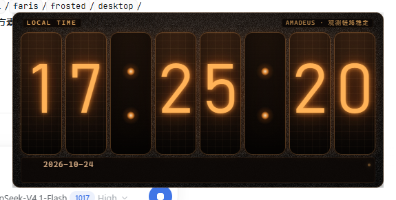
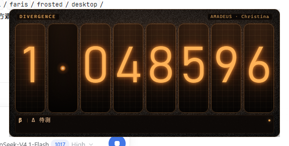
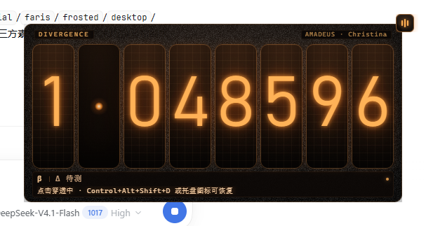

# 世界线变动率探测仪 · Worldline Divergence Meter

《命运石之门》主题的 Windows 桌面宠物：8 位辉光管、Amadeus 仪表气质、时间与世界线双模式。



> 默认是**纯 CSS 绘制**的数码管，克隆下来直接就能跑，不依赖任何图片。
> 想换成自己的美术素材，见[外观与素材](#外观与素材)。

---

## 特性

- **8 位辉光管**，时间模式 `HH:MM:SS`，世界线模式 `d.dddddd`
- **17 条特殊世界线**，每条带标签、台词与章节（`Steins;Gate 世界线`、`红莉栖 END`、`真由理 END`、菲利斯线等）
- **点击任意位置**让变动率漂移，连续点击才明显（`deltaTiers` 三段位移）
- **右键菜单**：切换模式、5 种背景材质、点击穿透、隐藏、退出
- **点击穿透**带多条退路（悬浮把手 / 快捷键 / 托盘），不会把自己锁死
- 位置记忆、单实例、无边框透明窗口、始终置顶
- 配置与文案**分离**：行为参数在 `config.json`，所有给人看的字在 `texts.json`
- 纯 CSS 外观 + 可选图片素材，两种模式自动切换





---

## 下载 / 安装

到 [Releases](../../releases) 下载 **`WorldlineDivergenceMeter-Setup.exe`**（约 110 MB）。

- 按用户安装，**不需要管理员权限**，装到 `%LOCALAPPDATA%\Programs\WorldlineDivergenceMeter`
- 开始菜单与桌面会创建快捷方式，并附带 `README.md`
- 卸载：设置 → 应用 → 卸载，或用安装目录里的 `uninstall.exe`
- 升级不会覆盖你改过的 `config.json` / `texts.json`

也可以直接用绿色版（`dist\WorldlineDivergenceMeter\`），双击 `Start.bat` 启动。

> ⚠️ 程序**未签名**，首次运行会弹 SmartScreen「Windows 已保护你的电脑」，点「更多信息 → 仍要运行」即可。

---

## 从源码运行

需要 Node.js 18+。

```powershell
npm install
npm start          # 等价于 node launch.js
```

或者双击 `start.bat`（内部同样走 `launch.js`，启动失败会自动加 `--no-sandbox` 重试）。

启动过程写入 `logs\app.log`，出问题先看这里。

---

## 外观与素材

程序启动时检测 `src\assets\tubes\0.png` 是否存在，**自动**选择外观：

| 条件 | 模式 | 外观 |
|---|---|---|
| 不存在 | `css` | 纯 CSS：渐变灯管 + 栅格网 + 字体辉光 + 径向渐变分隔点 |
| 存在 | `image` | 用 `tubes\*.png` 盖在字符上 |

日志会打印 `assets: mode = css (CSS nixie)` 或 `assets: mode = image (image tubes)`。

### 换成你自己的素材

1. 把图放进 `image\`，文件名固定：

   | 文件 | 用途 |
   |---|---|
   | `0.png` … `9.png` | 十个数字的灯管（可以是带背景的截图，脚本会自动抠底） |
   | `empty.png` | 不点亮的灯管 |
   | `dot.png` | 分隔点 |
   | `croix.png` | 菜单关闭图标 |
   | `fond.png` | 背板底图（可选） |

2. 运行：

   ```powershell
   powershell -ExecutionPolicy Bypass -File tools\prepare-assets.ps1
   ```

3. 生成到 `src\assets\`，下次启动自动切换到图片模式。该目录已被 `.gitignore` 忽略。

### 安装版怎么换素材

安装目录里同样带了 `image\` 和 `tools\prepare-assets.ps1`，不需要源码：

1. 把图放进**安装目录**下的 `image\`（打开「打开文件所在的位置」就能看到）
2. 在该目录打开 PowerShell，运行：

   ```powershell
   powershell -ExecutionPolicy Bypass -File .\tools\prepare-assets.ps1
   ```

3. 脚本会自动识别安装版布局，把结果输出到 `resources\app\src\assets\`；重启程序即生效。

> 安装目录里的 `image\` 只在本机使用，不会被程序分发出去。

> 换成自备素材后，管体改为图片渲染（此处不放截图，避免本仓库出现第三方美术内容）。

---

## 配置

### `config.json` —— 行为参数

| 段落 | 键 | 说明 |
|---|---|---|
| `window` | `alwaysOnTop` / `startMode` / `restoreLastMode` | 置顶、启动模式、是否恢复上次模式 |
| | `clickThrough` / `showTrayIcon` / `hideTaskbarIcon` / `hideOnStart` | 启动时的窗口行为 |
| | `rememberPosition` | 记住窗口位置 |
| | `toggleClickThroughHotkey` | 切换穿透，默认 `Control+Alt+Shift+D` |
| | `showHideHotkey` | 显示/隐藏，默认 `Control+Alt+Shift+S` |
| | `autoShowIfTrayHiddenMs` | 托盘图标不可见时，隐藏后多久自动放回（默认 15000，`0` 关闭） |
| `time` | `format` / `twentyFourHour` | 时间格式与 12/24 小时制 |
| `worldline` | `min` / `max` / `initialValue` | 变动率范围与初值（默认 1.048596） |
| | `specialChance` / `pityAfterMisses` | 特殊世界线概率 / 保底次数 |
| | `deltaTiers` | 三档位移，连续点击时逐级放大 |
| | `specialValues` | 17 条特殊世界线的 `value` 与 `weight` |
| `interaction` | `dragThresholdPx` | 拖拽判定阈值（像素） |
| | `specialAnimationMs` / `specialLabelHoldMs` | 特殊命中的动画与停留时长 |
| `appearance` | `uiScale` / `showHeader` / `scanlines` | 缩放、标题栏、扫描线 |
| | `background` | `none` / `dark` / `frosted` / `acrylic` / `fond` |

改完重启生效。

### `texts.json` —— 所有给人看的字

```json
{
  "brand": "AMADEUS",
  "status": { "time": "观测链路稳定", "worldline": "收束范围监测" },
  "worldlines": {
    "1.048596": { "label": "Steins;Gate 世界线", "quote": "「一切都是 Steins;Gate 的选择」", "chapter": "第十章" }
  }
}
```

- `worldlines` 的**键 = 界面上显示的数字**（负值按幅值写，例如菲利斯线用 `0.275349`）
- `label` → 状态条第一行；`quote` → 第二行台词；`chapter` → 顶部 `DIVERGENCE` 右侧的胶囊
- 只写想改的条目即可，其余用内置默认；文件损坏会备份成 `texts.json.broken-*` 后重建
- 记事本存出来的 BOM 也能正确读取

---

## 交互

| 操作 | 结果 |
|---|---|
| 单击 | 时间模式下无副作用；世界线模式让变动率漂移 |
| 拖动 | 移动窗口（阈值 `interaction.dragThresholdPx`） |
| 右键 | 打开菜单 |
| 穿透中想恢复 | 状态条第二行常驻提示 / 角上的琥珀色小把手 / `Ctrl+Alt+Shift+D` / 托盘左键 |
| 托盘右键 | 原生菜单（穿透、显示隐藏、任务栏、退出） |

### 穿透之后怎么回来

穿透开启后窗口点不动，所以有四层退路：

1. **状态条第二行常驻显示**恢复方式（不需要任何交互）
2. **桌宠右上角的恢复把手**：独立小窗口，永不穿透，点一下就恢复
3. **全局快捷键** `Ctrl+Alt+Shift+D`
4. **托盘图标**：左键单击会先关掉穿透再唤出窗口

另外，从菜单里开关穿透时**菜单不会关闭**，可以立刻再点一次撤销。

隐藏窗口后若检测到托盘图标不可见（`tray.getBounds()` 宽度为 0），会在
`autoShowIfTrayHiddenMs` 之后自动把窗口放回来，避免"把自己弄丢"。

---

## 开发

### 目录

```
src/main.js            主进程：窗口、托盘、菜单、快捷键、IPC、持久化
src/store.js           配置/状态读写（容忍 BOM）
src/worldline.js       纯逻辑：漂移、特殊命中、格式化
src/texts.js           文案加载与默认值
src/icon.js            托盘图标（PNG 优先，程序化兜底）
src/preload.js         contextBridge 白名单
src/renderer/          pet / menu / handle 三个界面
tools/                 素材管线、打包、安装包、开发用 CDP 驱动
test/                  21 项逻辑断言 + 24 项集成断言
config.json            行为参数
texts.json             全部文案
```

### 测试

```powershell
node test\acceptance.js    # 逻辑，21 项，不需要启动应用
node launch.js --remote-debugging-port=9222
node test\integration.js   # 集成，24 项，通过 CDP 驱动真实窗口
```

集成测试会真的发系统快捷键、读窗口扩展样式（`WS_EX_TRANSPARENT`）、验证穿透与恢复。

### 打包

```powershell
powershell -ExecutionPolicy Bypass -File tools\build-portable.ps1   # 绿色版 dist\WorldlineDivergenceMeter\
powershell -ExecutionPolicy Bypass -File tools\make-installer.ps1   # 安装包 dist\WorldlineDivergenceMeter-Setup.exe
```

- 打包用 NSIS 3.04（从 npmmirror 取，`tools\get-nsis.ps1` 会在缺失时自动下载）
- 打包时会**排除** `src\assets\`，确保本地自备素材不会被打进公开包
- 需要签名时用 `tools\sign.ps1`（可选；自签名只在装了证书的机器上可信）

---

## 已知限制

- **未签名**：首次运行有 SmartScreen 提示。要消除须购买代码签名证书。
- **exe 的图标与版本信息仍是 Electron 自带的**（改名不改资源），换图标需要 `rcedit`。
- **托盘图标在这一台机器上没被系统显示**（`tray.getBounds()` 恒为 0），
  所以做了"托盘不可见就自动放回窗口"的兜底；换机器可能正常显示。
- 集成测试里的窗口定位用 `EnumWindows` 枚举，而非 `MainWindowHandle`——后者会被
  26×26 的穿透把手窗口抢走。
- 安装包在本机的沙箱里只验证了文件解包；写注册表、建快捷方式等步骤在那里被系统拒绝，
  未能在沙箱内实测。

---

## 素材与版权

**本仓库不包含任何第三方美术素材。**

- `image/`、`src/assets/` 都不在版本库里（`.gitignore`）
- `src\assets-default\`、`src\assets\noise.png`、`tray-*.png` 均为本项目脚本绘制
- 默认用纯 CSS 绘制数码管，不加载任何图片
- 仓库**不提供也不链接**任何第三方素材下载；请使用你有权使用的素材

角色、名称与相关标识归其各自权利方所有；本项目为非官方粉丝作品，无隶属关系。
详见 [NOTICE.md](NOTICE.md)。

## License

代码以 [MIT](LICENSE) 发布。第三方素材不在 MIT 范围内，见 NOTICE。
